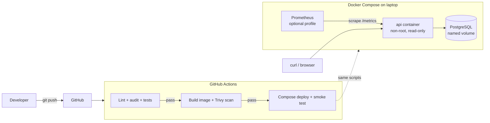

# Apex Operations API: DevOps Assessment

A small FastAPI service (operations tracker) packaged in Docker, deployed locally with
Docker Compose + PostgreSQL, with CI, versioned releases, rollback and basic observability.
All data is synthetic. No real credentials are used.

## Architecture



## Prerequisites
Docker (with Compose v2), `curl`, bash. For running tests outside Docker: Python 3.12.

## Quick start (exact steps)

```bash
cp .env.example .env            # then edit POSTGRES_PASSWORD to any local value
scripts/release.sh v1.0.0       # build versioned image apex-ops-api:v1.0.0
scripts/deploy.sh v1.0.0        # compose up + smoke test
curl localhost:8000/health
curl localhost:8000/ready
curl -X POST localhost:8000/operations -H 'content-type: application/json' -d '{"title":"Patch node"}'
curl localhost:8000/operations
curl localhost:8000/metrics | head
```

Optional metrics UI: `docker compose --profile monitoring up -d` then open http://localhost:9090.
Stop: `docker compose down` (data kept). Wipe data: `docker compose down -v`.

## Endpoints
| Endpoint | Purpose |
| --- | --- |
| `GET /health` | Liveness (process up) |
| `GET /ready` | Readiness (database reachable) |
| `GET /version` | Running version |
| `GET /metrics` | Prometheus metrics |
| `POST/GET /operations`, `GET /operations/{id}`, `PATCH /operations/{id}/status` | Business API |

## Run the tests
```bash
python -m venv .venv && source .venv/bin/activate
pip install -r requirements-dev.txt
ruff check .
pytest -v --cov=app
```
15 automated checks plus 1 intentional failure test (skipped unless
`RUN_INTENTIONAL_FAILURE=1`): 11 API/behaviour tests and 4 repo hygiene checks
(non-root user, no hard-coded passwords, `.env` ignored, `.dockerignore`).

## CI/CD (`.github/workflows/ci.yml`)
`test` (ruff, pip-audit, pytest) -> `build` (versioned image + Trivy) -> `deploy` (main only:
release script, Compose deploy, smoke test). Each job `needs` the previous one, so a failing
test blocks the build and deployment. To prove it: Actions > CI > Run workflow > tick
`simulate_failure`.

## Release and rollback
Images are tagged by version (`v1.0.0`, `sha-abc1234`), never `latest`.
`scripts/deploy.sh` records `.release/current` and `.release/previous`, runs a smoke test and
auto-rolls back if it fails. `scripts/rollback.sh` rolls back manually.
Full procedure: [docs/runbook.md](docs/runbook.md).

## Documents
- [docs/runbook.md](docs/runbook.md): deploy, rollback, incident response, troubleshooting
- [docs/failure-investigation.md](docs/failure-investigation.md): demonstrated DB failure
- [docs/security.md](docs/security.md): secrets, least privilege, scanning
- [docs/cloud-path.md](docs/cloud-path.md): cost-aware path to cloud hosting
- [docs/decision-memo.md](docs/decision-memo.md): decisions, assumptions, trade-offs
- [evidence/README.md](evidence/README.md): evidence checklist (screenshots/logs)

## Assumptions
Local Docker is the target environment; no cloud spend; GitHub Actions is available;
a single-node Postgres is acceptable for the demo.
